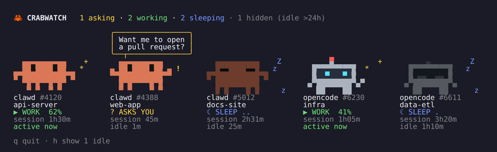
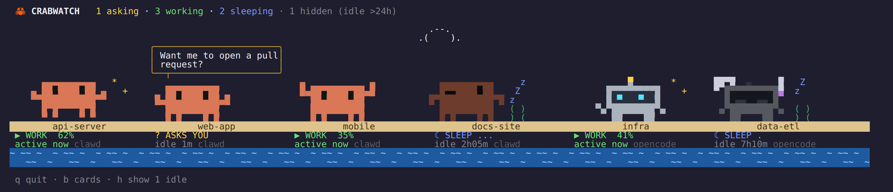

# crabwatch

A pixel-art terminal dashboard that shows your coding agents. Claude Code sessions are orange crabs (Clawd) and opencode sessions are robots. Each one is animated as **working** or **sleeping**.





## How it works
- Finds `claude` and `opencode` processes using `ps`.
- Adds up CPU use for each agent and all of its child processes, so running tools count as work. On Linux this comes from `/proc`; on macOS from `ps` and `lsof`.
- An agent is **working** when its CPU is at or above the threshold (default 5%). Otherwise it is **sleeping**.
- Each card shows the agent's project folder, PID, **model**, CPU %, **session time** and **idle time**. The model comes from the latest assistant message in the Claude transcript, or from the opencode session (`session_v2.model`, or the latest assistant message on older versions); the row stays blank until the agent has replied. Idle time is measured from the last transcript write or status change for Claude, and from the last session or message update for opencode.
- A Claude session counts as working only while Claude Code marks it `busy`. An opencode bot counts as working while its latest session is busy (`time_busy` / `time_idle` in `session_v2`); a busy flag not updated for 30 minutes is treated as stale. CPU is used only when neither is available. Idle time comes from real activity (messages, status changes), so CPU spikes from an idle app don't count.
- Cards (and the beach) are ordered by what needs you: agents asking you something first, then working, then sleeping.
- Agents idle for more than 24 hours are hidden (press `h` to toggle), and the header shows how many were hidden. An agent that is asking you something is never hidden. Change the limit with `--max-idle <hours>`; `--max-idle 0` shows everything.
- **Animations**: working agents scuttle sideways (faster with more CPU), sleeping ones breathe and sometimes peek with one eye, and agents waiting on you jump and wave. A state change plays a short scene: a startled jump when an agent wakes up, a yawn when it falls asleep, confetti when it finishes and asks you something.
- **Idle decay**: seaweed grows after 1h idle, a cobweb with a spider appears after 6h, and after 24h the agent is half buried in sand.
- **Bell**: with `--bell`, crabwatch rings the terminal bell once when one or more agents start waiting on you, so you notice even when the dashboard is in a background window or tmux pane. Agents already asking when crabwatch starts don't ring.
- **Beach view**: press `b` (or start with `--beach`) to put every agent on one shared beach with clouds and waves instead of cards.
- **Speech bubble**: appears when an agent is waiting on you. For Claude, that's an `AskUserQuestion` call, a permission prompt, or a final message ending in a question (read from the session transcript in `~/.claude/projects`). For opencode, it's a pending `question` tool call or a final question, read only from the `session`, `message` and `part` tables of `~/.local/share/opencode/opencode.db`.

## Requirements
- Node.js 20 or newer. No npm packages needed.
- Linux or macOS for live mode. Demo mode works anywhere.
- A terminal with truecolor support.

## Run
```bash
npm start                         # live dashboard
npm run demo                      # fake agents, randomly changing state
node src/dashboard.js --threshold 10   # use a different CPU % for "working"
node src/dashboard.js --max-idle 0    # also show agents idle for more than 24h
node src/dashboard.js --demo --beach  # start in the beach view
node src/dashboard.js --bell          # ring the terminal bell when an agent starts asking
node src/dashboard.js --json          # print one JSON snapshot of the agents and exit
node src/dashboard.js --help          # all options and keys
npm test
```
`--json` prints `{"counts": {"asking", "working", "sleeping", "hidden"}, "agents": [...]}` with each agent's `kind`, `pid`, `name`, `title`, `model`, `mood`, `state`, `question`, `cpu`, `sessionSec` and `idleSec`, in the same order and with the same `--max-idle` hiding as the dashboard. For example, a tmux status segment: `crabwatch --json | jq -r '"🦀 \(.counts.asking) asking"'`.

Keys: `b` switches between cards and the beach; `h` shows or hides the agents idle for more than 24h; `q` or `Ctrl-C` quits.
